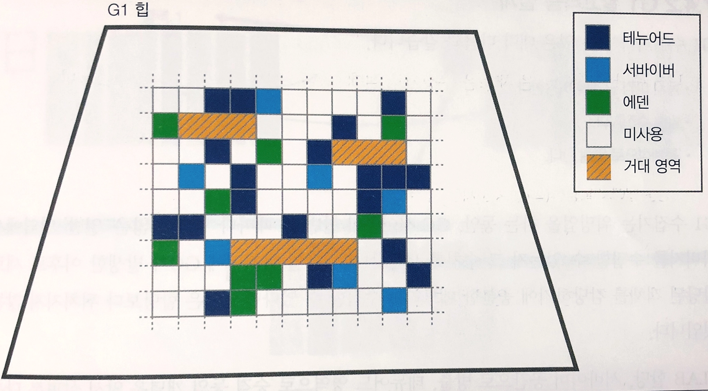

핫스팟에서 기본적으로 사용되는 가비지 컬렉터(G1)을 다룬다.

이 장에서는 잘 알려져 있지 않은 컬렉터를 소개한다.

- 셰넌도어
- Z 가비지 컬렉터(ZGC)
- Balanced
- 레거시 핫스팟 컬렉터

이 모든 컬렉터가 핫스팟 가상 머신에서 사용되지는 않는다. Balanced 컬렉터는 이클립스 OpenJ9에서 사용되는 컬렉터다.

## 5.1 트레이드오프와 플러그형 컬렉터

가비지 컬렉터는 매우 일반적인 컴퓨팅 기법이므로, 플러그인 방식으로 제공되는 것이 중요하다. 특히 하나의 알고리즘이 모든 작업에 적합하지 않기 때문에, 가비지 컬렉터 알고리즘은 상충하는 문제들 사이에서 타협이나 절충안을 제시한다.

개발자가 가비지 컬렉터를 선택할 고려할 주요 사항

- 애플리케이션 STW(일시 중지 시간 또는 지속 시간)
- 처리량(애플리케이션 실행 시간에 대비 가비지 컬렉터 실행 시간의 비율로 측정됨)
- 일시 중지 빈도(컬렉터가 애플리케이션을 중지해야 하는 빈도)
- 회수 효율성(단일 가비지 컬렉터가 수집할 수 있는 가비지의 양)
- 일시 중지의 일관성(모든 일시 중지가 대부분 일정한 길이인지 여부)

이 중에서도 일시 중지 시간은 매우 중요한 요소로 작용할 수 있다. 일시 중지는 많은 애플리케이션에서 중요하지만, 단독으로 고려해서는 안된다.

## 5.2 동시 가비지 컬렉션 이론

가비지 컬렉션의 비결정성은 직접적인 메모리 할당 동작으로 발생하며, 자바가 사용되는 많은 시스템은 매우 가변적인 메모리 할당 특성을 보인다.

가비지 컬렉터는 애플리케이션의 세부 사항을 알지 못하며, 단지 힙에 있는 실제 사용 중인 객체(live object)의 그래프만을 추적할 뿐이다. 이는 자바 가비지 컬렉션에서 비결정성이 더욱 심화된다.


<aside>

이 방식의 단점은 적절한 계산이 지연된다는 점이며, 주요 문제는 이러한 가비지 컬렉션 간섭의 예측 불가능성이다.

</aside>

현대 가비지 컬렉션 이론의 출발점은 데이크스트라가 지적한 것처럼

STW의 지속 시간과 빈도가 비결정적이라는 점이 가비지 컬렉션 기술을 사용하는 데 있어 주요한 불편 요소라는 통찰에서 시작했다.

### 5.2.1 자바 가상 머신 세이프포인트

STW 가비지 컬렉션을 수행하려면, 핫스팟의 병렬 컬렉터가 하는 것처럼 모든 애플리케이션 스레드를 중지해야 한다.

<aside>

자바 가상 머신은 실제로 완전히 선점형 멀티스레딩 환경이 아니다. 이는 자바에서 잘 알려지지 않은 사실이다.

</aside>

운영체제는 얼마든지 스레드를 선점할 수 있다.

- 자바 가상 머신 런타임은 각 애플리케이션 스레드가 세이프포인트라고 불리는 특정 실행 지점을 가지도록 요구한다.
- 이 지점에서 스레드의 내부 데이터 구조는 안정된 상태를 유지하며, 스레드는 조정된 작업을 위해 중단될 수 있다.

### 5.2.2 삼색 마킹

### 5.2.3 포워딩 포인터

## 5.3 G1

특징

- 동시 마크 스윕보다 튜닝이 훨씬 쉬움
- 조기 승격에 덜 취약함
- 큰 힙에서 더 나은 확장성(특히 일시 정지 시간)을 가짐
- 전체 STW 컬렉션으로 돌아갈 필요성을 크게 줄임

시간이 지나면서 G1은 범용 컬렉터로 인식되기 시작했다.

G1에서 가장 중요한 개념은 일시 정지 목표다.이 기능을 통해 개발자는 애플리케이션이 가비지 컬렉션 주기마다 일시 정지해야 하는 최대 시간을 설정할 수 있다.

하지만 이는 목표로 표현될 뿐이며, 애플리케이션이 이를 달성할 수 있다는 보장은 없다.

일시 정지 목표의 기본값은 200ms다. 힙 크기가 매우 큰 애플리케이션으 경우, 일시 정지 목표를 조정해야할 수도 있다.

G1 컬렉터의 설계에서 또 다른 큰 차이점은 지금까지 살펴본 세대 개념을 재구성했다는 점이다. 특히 병렬 컬렉터와 달리, G1은 각 세대마다 연속된 전용 메모리 공간을 갖고 있지 않고, 대신 영역을 갖는다.

### 5.3.1 G1 힙 레이아웃과 영역

- G1 힙은 고정 크기의 영역 개념을 기반으로 하며, 이러한 영역이 모여 세대를 구성
- 이 영역들은 1MB 크기이지만, 더 큰 힙에서는 그 크기가 더 커질 수 있다.
- 영역을 사용하는 것은 비연속적인 세대를 가능하게 한다.
    - 각 실행 시 모든 가비지를 수집할 필요가 없는 컬렉터 단계적 수집을 가능하게 한다.

<aside>

전체 G1 힙은 여전히 메모리에서 연속적이지만, 각 세대를 구성하는 메모리가 더 이상 연속적일 필요는 없다.

</aside>

G1 힙의 영역 기반 레이아웃은



G1에는 여전히 젊은 세대 개념이 있으며, 이는 에덴과 서바이버 영역으로 구성된다.

자바 21부터 G1 알고리즘은 2의 제곱 MB 크기의 영역을 허용한다.

기본적으로 G1은 힙에서 2048~4095개의 영역을 기대하며, 이를 달성하기 위해 영역 크기를 조정한다.

영역 크기를 계산하기 위해 다음 값을 사용한다.

```java
<heap size> / 2048
```

계산된 값을 가장 가까운 허용 영역 크기 값으로 내림처리한다. 그런 다음 영역의 수를 다음과 같이 계산한다.

```java
Number of regions = <Heap size> / <region size>
```

- 애플리케이션에서 영역 크기의 절반보다 큰 객체를 생성하는 경우, 이를 거대한 객체로 간주한다.
- 이러한 객체는 거대한 영역에 직접 할당된다.
    - 즉시 젊은 세대가 아닌 영구 세대의 일부가 된다.
    - 일반 적인 예는 거대 배열

### 5.3.2 G1 컬렉션

G1 컬렉터에는 두 가지 유형의 컬렉션이 있습니다.

- 젊은 세대 가비지 컬렉션
    - 수집 대상이 되는 영역은 젊은 세대 영역만 포함한다.
- 혼합 컬렉션
    - 컬렉션 집합에 영 영역과 오래된 영역이 모두 포함된다.

- 젊은 세대 가비지 컬렉션은 가능한 한 빨리 힙을 회수하려고 하는 STW 컬렉션이다. 이 과정에서 메모리 영역을 완전히 비워 즉시 재사용할 수 있다.
    - 워밍업 중에 컬렉터는 가비지 컬렉션 실행 당 얼마나 많은 ‘일반적인’ 영역을 수집할 수 있는지를 추적
    - 컬렉터가 할당 속도보다 앞서 나갈 수 있는 한, 일시 정지 시간을 제어할 수 있음
- 혼합 컬렉션은 대부분 동시로 수행되며, 오래된 객체의 수가 충분히 증가하여 젊은 세대 가비지 컬렉션만으로는 충분한 메모리를 회수할 수 없을 때 사용된다.
    - IHOP: 혼합 컬렉션이 시작되는 시점을 초기 힙 점유율 비율 임계값이라고 한다.
    - G1은 이전 애플리케이션의 동작을 바탕으로 초기 힙 점유율 비율을 자동으로 결정한다.(기본 초기 값은 45%)

G1은 다음과 같은 개념으로 설명할 수 있다.

- 영역 기반이며, 세대별 컬렉터이다.
- 객체를 이동시키는 방식의 가비지 컬렉터다.
- ‘통계적 압축’을 제공한다.
- 혼합 컬렉션을 위해 동시 마킹 단계를 사용한다.

### 5.3.3 혼합 컬렉션

G1 혼합 컬렉션은 대부분 애플리케이션 스레드와 동시에 실행된다는 점이다. 기본적으로 사용 가능한 코어 중 일부(최소 하나)는 G1의 동시 단계를 수행하고, 나머지 코어는 애플리케이션 코드를 계속해서 실행한다.

이에 두 가지 주요 결과가 발생한다.

1. 혼합 컬렉션이 실행되는 동안 애플리케이션 처리량이 감소한다.
2. 동시 컬렉션이 진행 중일 때 젊은 세대 가비지 컬렉션을 수행할 수 있다.

G1 Old에는 네 가지 단계가 있다.

1. 동시 시작(STW G1 New 포함)
2. 동시 마킹
3. 재마킹(STW)
4. 클린업(STW)

G1 Old는 대부분의 실행 시간 동안 애플리케이션 스레드와 나란히 실행된다.

전반적인 효과는 긴 STW 일시 정지 하나를 세 번의 STW 일시 정지로 대체하는 것이다. 이들 일시 정지는 보통 매우 짧다.

### 5.3.4 기억 집합

G1 컬렉터는 영역 추적을 돕기 위해 이와 관련된 기능을 제공한다.

기억집합(RSet)은 영역별로 존재하며, 힙 영역으로 포인팅하는 외부 참조를 추적한다.

G1은 영역으로 포인팅하는 참조를 찾기 위해 전체 힙을 추적하는 대신 기억 집합만 검사하고, 해당 영역을 스캔하여 참조를 찾으면 된다.

- 기억 집합 기법은 부유 가비지라는 가비지 컬렉션 문제를 초래할 수 있다.
    - 부유 가비지란, 현재 수집 집합에 포함되지 않은 죽은 객체에서 오는 참조 때문에 실제로는 죽은 객체가 계속 살아남게 되는 문제
- 혼합 컬렉션의 클린업 단계 동안 G1은 기억 집합 세척 작업을 수행한다.
    - 비워진 영역으로 포인팅하던 영역의 기억 집합을 검사하고, 다른 영역으로 이동된 객체에 대한 참조를 업데이터하는 작업

### 5.3.5 전체 컬렉션

전체 컬렉션은 STW 방식으로 수행.

- 힙 전체(젊은 세대와 영구 세대 공간 모두)를 정리한다.
- 거대한 객체가 할당된 영역 내의 객체를 제자리에서 압축한다.

전체 컬렉션은 여러 가지 이유로 발생할 수 있으며, 그중 하나는 거대한 영역의 단편화.

이러한 단편화가 발생하면 충분한 여유 메모리가 있더라도 연속된 블록으로 공간이 확보되지 않아 거대한 객체의 할당이 실패할 수 있다.

### 5.3.6 G1을 위한 자바 가상 머신 설정 플래그

- 만약 동시 모드가 실패하여 전체 가비지 컬렉션이 너무 자주 발생한다면, 초기 힙 점유율 비율 임계값을 조정할 수 있다.
- 먼저 시도할 것은 혼합 컬렉션을 시작하는 임계값을 낮추도록 jvm에 요청하는 것
    - 이는 초기 힙 점유율 비율 계산에 사용되는 버퍼 크기를 늘림으로써 수행

```java
-XX:G1ReservePercent=10
```

- 힙 점유율 비율의 적응적 계산을 비활성화하고 수동으로 설정할 수도 있지만, 이는 대부분의 애플리케이션에 권장되지 않는다.
    - 적응적 접근이 효과가 없을 때만 시도해야 한다.

```java
-XX:-G1UseAdaptiveIHOP
-XX:InitiatingHeapOccupancyPercent=45
```

특정 상황에서는 적응적 동작을 유지하면서 초기 힙 점유율 비율의 초기 값만 변경하고 싶을 수 있다. 이 경우에는 다음과 같이 -XX:InitiatingHeapOccupancyPercent=<n>만 설정하면 된다.

또 다른 옵션으로는 기본 알고리즘을 무시하고 영역 크기를 변경하는 방법이 있다.

```java
-XX:G1HeapRegionSize=<n>m
```

<n>은 이전과 마찬가지로 1~512 사이의 2의 거듭제곱이어야 하며, 단위는 MB다.