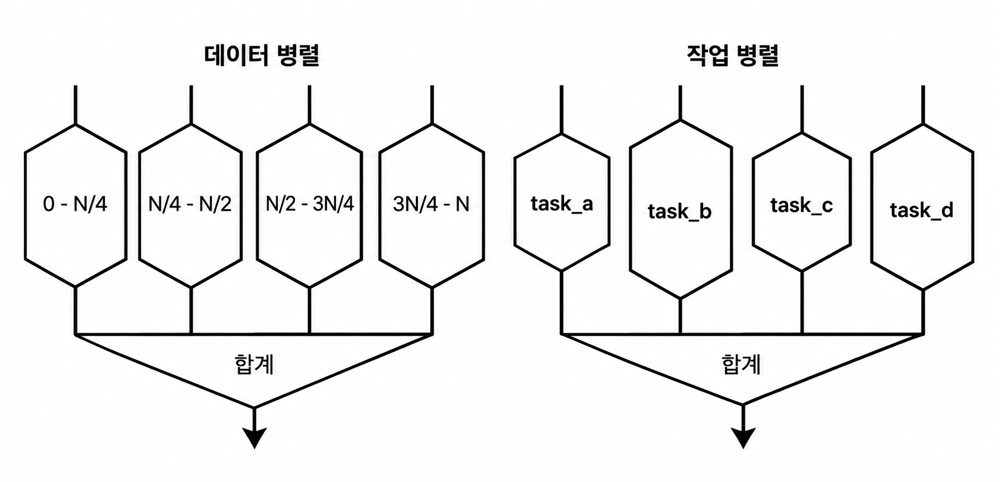

잘 작성된 현대 애플리케이션은 애플리케이션 처리를 여러 코어에 분산하여 성능을 극대화해야 합니다.
JVM과 같은 플랫폼은 이러한 환경에서 뚜렷한 이점을 가지고 있습니다.
JVM은 JIT 컴파일이나 GC 같은 작업을 수행할 때,
항상 여러 프로세서 코어를 활용할 수 있는 Virtual Machine Thread가 존재하기 떄문입니다.
따라서 단일 애플리케이션 스레드만 사용하는 JVM 애프리케이션 조차도 멀티코어 하드웨어의 혜택을 받을 수 있습니다.

## 병렬 처리



- 데이터 병렬성: 큰 데이터 풀에서 작업하는 단일의 대구모 작업을 더 작은 단위로 세분화하는 것
- 작업 병렬성: 서로 다른 작업을 여러 프로세서에 나누어 실행하는  것

### 기본적인 자바 동시성

```java
public class Counter {
    private int i = 0;
    public int increment() {
        return i = i + 1;
    }
}
```

이 코드에서 만일 카운터가 락으로 보호되지 않은 상태에서 다른 스레드가 접근하면,
한 스레드가 값을저장하기 전에 다른 스레드가 값을 먼저 로그하여 업데이트 손실을 초래하는 lost update 문제가 발생할 수 있습니다.

그럼 단일 CPU 환경에서도 동일한 문제가 발생할 수 있을까요?
각 스레든는 메서드에 진입할 때마다 개별적인 평가 스택을 갖게 되므로, 실제로 충돌할 수 있는 부분은 필드에 대한 연산뿐입니다.
(객체 필드는 힙에 저장되며, 힙은 모든 스레드가 공유하기 때문입니다.)
그래서 이 문제는 단일 CPU 환경에서도 발생할 수 있습니다.

그렇다면 volatile 키워드를 사용하면 문제가 해결될까요?
volatile 키워드를 추가하면 증가 연산이 안전해질 것으로 생각할 수 있지만, 실제로는 그렇지 않습니다.
volatile을 사용하면 값이 항상 캐시에서 다시 읽히도록 강제되어, 다른 스레드에서도 모든 업데이트를 확인할 수 있게 보장합니다.
그러나 volatile은 단순히 메모리에 값을 쓰고 읽는 순서를 보장하는 것이지, CPU 캐시 동기화를 보장하지 않습니다.
따라서 volatile 키워드만으로는 동시성 문제를 완전히 해결할 수 없습니다.

물론 synchronized 키워드를 사용해 int와 같은 단순한 값의 업데이트를 제어할 수도 있습니다.
하지만 동기화를 사용할 때 맹목적으로 추가하면, 오히려 프로그램 속도가 느려질 수 있습니다.

### 자바 메모리 모델

공유 상태에 접근하는 모든 곳에서, 플랫폼은 자바 메모리 모델이 제시하는 보장을 준수하도록 합니다.
- 순서에 관련된 보장
- 스레드 간 업데이트 가시성에 관련된 보장

자바 메모리 모델과 같은 메모리 모델이 취할 수 있는 접근 방식은 두 가지가 있습니다.
- 강한 메모리 모델: 모든 코어가 언제나 동일한 값을 봅니다.
- 약한 메모리 모델: 코어마다 서로 다른 값을 볼 수 있습니다. (예: CPU 캐시)

만약 멀티 CPU 시스템 위에 강한 메모리 모델을 구현한다면, 이는 메모리에 대한 쓰기 반영 방식과 동일하게 동작합니다.
즉, 캐시 무효화 알림이 메모리 버스를 가득 채우게 되어, 메인 메모리와의 실질적인 데이터 전송 속도가 급격히 떨어지게 됩니다.
이러한 문제는 코어가 증가할 수록 더욱 심각해집니다.

실제 자바 메모리 모델은 매우 약한 메모리 모델을 채택하고 있습니다.

### 동시성 라이브러리

jaca.utilconcurrent 라이브러리는 자바에서 멀티스레드 애플리케이션을 작성할 때 유용한 도구를 제공합니다.
- 스레드핫 성능의 이점이 있음. 스레드 핫이란, 스레드가 대부분의 시간을 실행에 사용하고 동일한 구조에서 수행하는 다른 스레드와 경쟁하지 않는 동시성 프로파일
- 제공되는 구축 범위
  - 잠금과 세마포어
  - 래치
  - 원자적 연산
  - 실행자
  - 차단 큐

### 원자적 연산 또는 비교와 호환

자바의 원자적 연산 정수 클래스(java.util.concurrent.atomic.AtomicInteger)는 add, increment, decrement와 같은 복합 연산을 제공하며, 이는 `get()`과 결합하여 영향을 받은 결과를 반환합니다.
원자적 변수의 의미로는 volatile의 확장이지만, 더 유연합니다.
스레드 기반 연산이 가시성을 보장하기 위해 동기화할 필요 없이 수행됩니다.

AtomicInteger는 Integer를 상속하지 않습니다. Integer가 불변 객체를 나타내는 반면, AtomicInteger는 명시적으로 스레드 안전한 가변 값을 나타내기 때문입니다.
원자적 연산은 CAS(Compare-And-Swap)을 사용하여 구현됩니다.
이는 기대하는 현재의 값(expected)과 원하는 새로운 값(wanted)을 사용하며, 메모리 위치(포인터)와 함께 동작합니다.
원자적 연산 단위로 두 개의 연산이 이루어집니다.
- 기대하는 현재 값을 메모리 위치의 실제 값과 비교합니다.
- 만약 두 값이 일치하면, 현재 값을 원하는 새로운 값으로 교체합니다.
- 만약 두 값이 일치하지 않으면, 아무런 작업도 수행하지 않고 실패를 반환합니다.

> ABA 문제: 만약 스레드 A가 메모리 위치의 값을 읽고, 스레드 B가 그 값을 변경한 후 다시 원래 값으로 되돌린다면, 스레드 A는 값이 변경되지 않았다고 판단할 수 있습니다.
> ABA 문제를 해결하기 위해, 원자적 연산은 종종 버전 번호를 함께 사용하여 값이 변경되었는지 확인합니다.
> 버전 번호는 시간 스탬프나 또다른 원자적 카운터로 구현할 수 있습니다.

### 락(잠금)

- `lock()`: 락을 획득하며, 잠금이 사용 가능할 때까지 차단됩니다.
- `newCondition()`: 조건 변수를 생성하여 보다 유여한 사용이 가능하게 합니다.
- `tryLock()`: 락을 시도하며, 잠금이 사용 가능하면 획득하고 true를 반환하며, 그렇지 않으면 false를 반환합니다.
- `unlock()`: 락을 해제합니다.
- `ReentrantLock`: 재진입 가능한 락으로, 동일한 스레드가 여러 번 획득할 수 있습니다. 스레드가 스스로를 차단하는 것을 방지합니다.  이로 인해 대기 중인 스레드가 공정하게 락을 획득할 수 있도록 보장합니다.

### 동시 컬렉션

- ConcurrentHashMap: 버킷 또는 세그먼트로 분할되는 방식을 사용합니다.
  - 각 세그먼트는 자체적인 락 정책을 가질 수 있고, 개별적인 락을 사용할 수 있습니다.
  - 여러 세그먼트에서 동시에 읽을 수 있으며, 쓰기 연산이 필요할 경우 세그먼트에만 잠금이 적용됩니다.
  - 충돌이 너무 잦아질 경우, 동적으로 확장되며, 미리 세그먼트 수를 늘려 충돌을 줄일 수 있습니다.
